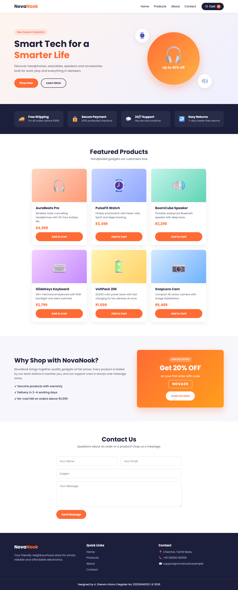
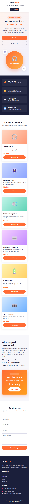

# Ex.No: 02 – Commercial Website using Flexbox
## Date: 02.11.2026

## AIM
To design and develop a responsive commercial website for a fictional electronics store, "NovaNook", using HTML and CSS Flexbox, so that the navigation bar, product sections and footer adapt cleanly across desktop, tablet and mobile screen sizes.

## DESIGN STEPS

### Step 1:
Create the HTML structure (index.html) with a header, hero, features strip, products section, about/offer banner, contact form and footer, and link the stylesheet (style.css) and the Poppins Google Font.

### Step 2:
Apply Flexbox to the navbar using `display: flex`, `justify-content: space-between` and `align-items: center` to place the logo on the left and the nav links and cart button on the right.

### Step 3:
Build the hero section as a flex container with the text and "Shop Now" button on one side and a CSS illustration on the other, followed by a features strip whose items share space using `flex: 1` and `gap`.

### Step 4:
Build the product grid with a `flex-wrap: wrap` container and product cards sized with `flex: 1 1 250px`. Make each card a flex column and push the "Add to Cart" button to the bottom with `margin-top: auto`.

### Step 5:
Add the footer as a flex row with three columns (brand info, quick links, contact) and a bottom bar showing "Designed by A. Sherwin Infano | Register No: 212224040312 | © 2026".

### Step 6:
Add media queries at 992px, 768px and 480px that switch `flex-direction` to `column`, adjust wrapping and resize fonts.

### Step 7:
Test the website in the browser at desktop (1366px) and mobile (390px) widths, fix any layout issues, then push the project to GitHub.

## WORKING PRINCIPLE

### What is Flexbox?
CSS Flexbox (Flexible Box Layout) is a one-dimensional layout model. It arranges elements in a single row or a single column and distributes the available space between them, which makes it ideal for building layouts that adapt to different screen sizes.

### Flex container and flex items
- The **flex container** is the parent element on which `display: flex` is set.
- Its direct children automatically become **flex items**, which the container lines up and sizes according to the flex properties.

### Main axis and cross axis
- The **main axis** is the direction in which flex items are placed. It is horizontal (left to right) for `flex-direction: row` and vertical (top to bottom) for `flex-direction: column`.
- The **cross axis** runs perpendicular to the main axis.
- `justify-content` works along the main axis, while `align-items` works along the cross axis.

### Key properties
| Property | Applies to | Purpose |
|---|---|---|
| `flex-direction` | Container | Sets the main axis: `row` (default), `row-reverse`, `column` or `column-reverse`. |
| `justify-content` | Container | Aligns items along the main axis: `flex-start`, `center`, `flex-end`, `space-between`, `space-around`, `space-evenly`. |
| `align-items` | Container | Aligns items along the cross axis: `stretch` (default), `flex-start`, `center`, `flex-end`, `baseline`. |
| `flex-wrap` | Container | `nowrap` (default) keeps all items on one line; `wrap` lets items flow onto new lines when space runs out. |
| `gap` | Container | Sets fixed spacing between flex items without using margins. |
| `flex-grow` | Item | How much of the leftover space an item takes (0 means it does not grow). |
| `flex-shrink` | Item | How much an item shrinks when there is not enough space (0 means it does not shrink). |
| `flex-basis` | Item | The item's starting size before growing or shrinking. |
| `flex` | Item | Shorthand for `flex-grow flex-shrink flex-basis`. For example, `flex: 1` means "grow and shrink equally from a basis of 0", and `flex: 1 1 250px` means "start at 250px, then grow or shrink as needed". |
| `align-self` / `margin-top: auto` | Item | Overrides alignment for one item; an `auto` margin absorbs the free space and pushes the item away. |

### How each section of this website uses Flexbox
- **Header / navbar:** `.header` is a flex row with `justify-content: space-between` and `align-items: center`, so the logo sits on the left and the `.nav` group (itself a flex row of links and the cart button) sits on the right, all vertically centred.
- **Hero:** `.hero` is a flex row. `.hero-text` and `.hero-visual` both use `flex: 1`, so they share the width equally. The circular illustration is centred inside `.hero-visual` using `justify-content` and `align-items: center`.
- **Features strip:** each `.feature` has `flex: 1`, so the four items stretch to equal widths, and `gap` spaces them evenly. Each feature is also a small flex row aligning the icon with its text.
- **Products:** `.product-list` uses `flex-wrap: wrap` and every `.product-card` uses `flex: 1 1 250px`. Cards start at 250px wide and grow to fill each row; when a row runs out of space the next card wraps to a new line. Each card is a `flex-direction: column` container, and `margin-top: auto` on the "Add to Cart" button pushes it to the bottom, so all buttons line up even when descriptions have different lengths.
- **About / offer banner:** `.about` is a two-column flex row where `flex: 3` and `flex: 2` give the text and the offer box a 3:2 width ratio. The offer box is a centred flex column.
- **Contact form:** `.contact-form` is a flex column with `gap` between fields, and `.form-row` is a flex row in which the name and email inputs each take `flex: 1`.
- **Footer:** `.footer-cols` is a flex row with three `flex: 1` columns, and `.footer-bottom` centres the credits line with `justify-content: center`.

### How the media queries make the layout responsive
- **max-width: 992px (tablets / small laptops):** the features strip gets `flex-wrap: wrap` with items at roughly half width, giving a 2 × 2 layout. The about section switches to `flex-direction: column` so the offer box moves below the text, and the hero heading shrinks.
- **max-width: 768px (tablets / large phones):** the header switches to `flex-direction: column` with the nav links wrapping and centred. The hero becomes a column with the illustration below the text, the footer's three columns stack vertically, and section headings get smaller.
- **max-width: 480px (phones):** the features strip, hero buttons and the name/email form row all switch to `flex-direction: column`. The send button stretches to full width, fonts and illustration bubbles shrink, and product cards (which have a 250px basis) wrap to one card per row.

Because every layout is built with Flexbox, these changes only need a few property overrides (mainly `flex-direction` and `flex-wrap`) for the same HTML to flow from a multi-column desktop layout to a single-column mobile layout.

## PROGRAM

### index.html
```html
<!DOCTYPE html>
<html lang="en">
<head>
  <meta charset="UTF-8">
  <meta name="viewport" content="width=device-width, initial-scale=1.0">
  <title>NovaNook | Smart Electronics Store</title>
  <link rel="icon" href="data:,">
  <link rel="preconnect" href="https://fonts.googleapis.com">
  <link rel="preconnect" href="https://fonts.gstatic.com" crossorigin>
  <link href="https://fonts.googleapis.com/css2?family=Poppins:wght@400;500;600;700&display=swap" rel="stylesheet">
  <link rel="stylesheet" href="style.css">
</head>
<body>
  <!-- Header / Navigation -->
  <header class="header">
    <a href="#home" class="logo">Nova<span>Nook</span></a>
    <nav class="nav">
      <ul class="nav-links">
        <li><a href="#home">Home</a></li>
        <li><a href="#products">Products</a></li>
        <li><a href="#about">About</a></li>
        <li><a href="#contact">Contact</a></li>
      </ul>
      <a href="#products" class="cart-btn">🛒 Cart <span class="cart-count">0</span></a>
    </nav>
  </header>

  <!-- Hero -->
  <section id="home" class="hero">
    <div class="hero-text">
      <span class="hero-tag">New Season Collection</span>
      <h1>Smart Tech for a <span>Smarter Life</span></h1>
      <p>Discover headphones, wearables, speakers and accessories built for work, play and everything in between.</p>
      <div class="hero-actions">
        <a href="#products" class="btn btn-primary">Shop Now</a>
        <a href="#about" class="btn btn-ghost">Learn More</a>
      </div>
    </div>
    <div class="hero-visual">
      <div class="device">
        <span class="device-icon">🎧</span>
        <p>Up to 40% off</p>
      </div>
      <div class="bubble bubble-one">⌚</div>
      <div class="bubble bubble-two">🔊</div>
    </div>
  </section>

  <!-- Features strip -->
  <section class="features">
    <div class="feature">
      <span class="feature-icon">🚚</span>
      <div>
        <h3>Free Shipping</h3>
        <p>On all orders above ₹999</p>
      </div>
    </div>
    <div class="feature">
      <span class="feature-icon">🔒</span>
      <div>
        <h3>Secure Payment</h3>
        <p>100% protected checkout</p>
      </div>
    </div>
    <div class="feature">
      <span class="feature-icon">💬</span>
      <div>
        <h3>24/7 Support</h3>
        <p>We are here anytime</p>
      </div>
    </div>
    <div class="feature">
      <span class="feature-icon">↩️</span>
      <div>
        <h3>Easy Returns</h3>
        <p>7-day hassle-free returns</p>
      </div>
    </div>
  </section>

  <!-- Products -->
  <section id="products" class="products">
    <div class="section-head">
      <h2>Featured Products</h2>
      <p>Handpicked gadgets our customers love</p>
    </div>
    <div class="product-list">
      <article class="product-card">
        <div class="product-img img-1">🎧</div>
        <div class="product-body">
          <h3>AuraBeats Pro</h3>
          <p>Wireless noise-cancelling headphones with 40-hour battery life.</p>
          <span class="price">₹4,999</span>
          <button class="btn btn-primary add-cart">Add to Cart</button>
        </div>
      </article>
      <article class="product-card">
        <div class="product-img img-2">⌚</div>
        <div class="product-body">
          <h3>PulseFit Watch</h3>
          <p>Fitness smartwatch with heart-rate, SpO2 and sleep tracking.</p>
          <span class="price">₹3,499</span>
          <button class="btn btn-primary add-cart">Add to Cart</button>
        </div>
      </article>
      <article class="product-card">
        <div class="product-img img-3">🔊</div>
        <div class="product-body">
          <h3>BoomCube Speaker</h3>
          <p>Portable waterproof Bluetooth speaker with deep bass.</p>
          <span class="price">₹2,299</span>
          <button class="btn btn-primary add-cart">Add to Cart</button>
        </div>
      </article>
      <article class="product-card">
        <div class="product-img img-4">⌨️</div>
        <div class="product-body">
          <h3>GlideKeys Keyboard</h3>
          <p>Slim mechanical keyboard with RGB backlight and silent switches.</p>
          <span class="price">₹2,799</span>
          <button class="btn btn-primary add-cart">Add to Cart</button>
        </div>
      </article>
      <article class="product-card">
        <div class="product-img img-5">🔋</div>
        <div class="product-body">
          <h3>VoltPack 20K</h3>
          <p>20,000 mAh power bank with fast charging for two devices at once.</p>
          <span class="price">₹1,599</span>
          <button class="btn btn-primary add-cart">Add to Cart</button>
        </div>
      </article>
      <article class="product-card">
        <div class="product-img img-6">📷</div>
        <div class="product-body">
          <h3>SnapLens Cam</h3>
          <p>Compact 4K action camera with image stabilisation.</p>
          <span class="price">₹6,499</span>
          <button class="btn btn-primary add-cart">Add to Cart</button>
        </div>
      </article>
    </div>
  </section>

  <!-- About / Offer banner -->
  <section id="about" class="about">
    <div class="about-text">
      <h2>Why Shop with NovaNook?</h2>
      <p>
        NovaNook brings together quality gadgets at fair prices. Every product is tested
        by our team before it reaches you, and our support crew is always one message away.
      </p>
      <ul class="about-points">
        <li>✔ Genuine products with warranty</li>
        <li>✔ Delivery in 2–4 working days</li>
        <li>✔ No-cost EMI on orders above ₹2,999</li>
      </ul>
    </div>
    <div class="offer-box">
      <span class="offer-tag">Limited Offer</span>
      <h3>Get 20% OFF</h3>
      <p>on your first order with code</p>
      <span class="offer-code">NOVA20</span>
      <a href="#products" class="btn btn-light">Grab the Deal</a>
    </div>
  </section>

  <!-- Contact -->
  <section id="contact" class="contact">
    <div class="section-head">
      <h2>Contact Us</h2>
      <p>Questions about an order or a product? Drop us a message.</p>
    </div>
    <form class="contact-form" action="#" onsubmit="return false;">
      <div class="form-row">
        <input type="text" placeholder="Your Name" aria-label="Your Name" required>
        <input type="email" placeholder="Your Email" aria-label="Your Email" required>
      </div>
      <input type="text" placeholder="Subject" aria-label="Subject">
      <textarea rows="5" placeholder="Your Message" aria-label="Your Message" required></textarea>
      <button type="submit" class="btn btn-primary">Send Message</button>
    </form>
  </section>

  <!-- Footer -->
  <footer class="footer">
    <div class="footer-cols">
      <div class="footer-col">
        <a href="#home" class="logo">Nova<span>Nook</span></a>
        <p>Your friendly neighbourhood store for smart, reliable and affordable electronics.</p>
      </div>
      <div class="footer-col">
        <h4>Quick Links</h4>
        <ul>
          <li><a href="#home">Home</a></li>
          <li><a href="#products">Products</a></li>
          <li><a href="#about">About</a></li>
          <li><a href="#contact">Contact</a></li>
        </ul>
      </div>
      <div class="footer-col">
        <h4>Contact</h4>
        <ul>
          <li>📍 Chennai, Tamil Nadu</li>
          <li>📞 +91 00000 00000</li>
          <li>✉️ support@novanook.example</li>
        </ul>
      </div>
    </div>
    <div class="footer-bottom">
      <p>Designed by A. Sherwin Infano | Register No: 212224040312 | &copy; 2026</p>
    </div>
  </footer>
</body>
</html>
```

### style.css
```css
/* ===== Base ===== */
:root {
  --primary: #ff6b35;
  --primary-dark: #e0551f;
  --dark: #1b1f3b;
  --text: #4a4e69;
  --light: #f7f7fb;
  --white: #ffffff;
  --radius: 14px;
  --shadow: 0 8px 24px rgba(27, 31, 59, 0.08);
}

* {
  margin: 0;
  padding: 0;
  box-sizing: border-box;
}

html {
  scroll-behavior: smooth;
  scroll-padding-top: 80px;
}

body {
  font-family: "Poppins", sans-serif;
  color: var(--text);
  background: var(--white);
  line-height: 1.6;
}

a {
  text-decoration: none;
  color: inherit;
}

ul {
  list-style: none;
}

h1, h2, h3, h4 {
  color: var(--dark);
  line-height: 1.25;
}

/* ===== Buttons ===== */
.btn {
  display: inline-flex;
  justify-content: center;
  align-items: center;
  padding: 12px 28px;
  border: 2px solid transparent;
  border-radius: 50px;
  font-family: inherit;
  font-size: 0.95rem;
  font-weight: 600;
  cursor: pointer;
  transition: background 0.25s, color 0.25s, transform 0.25s, box-shadow 0.25s;
}

.btn:hover {
  transform: translateY(-3px);
}

.btn-primary {
  background: var(--primary);
  color: var(--white);
}

.btn-primary:hover {
  background: var(--primary-dark);
  box-shadow: 0 8px 20px rgba(255, 107, 53, 0.35);
}

.btn-ghost {
  border-color: var(--dark);
  color: var(--dark);
}

.btn-ghost:hover {
  background: var(--dark);
  color: var(--white);
}

.btn-light {
  background: var(--white);
  color: var(--primary);
}

.btn-light:hover {
  box-shadow: 0 8px 20px rgba(0, 0, 0, 0.2);
}

/* ===== Header / Navbar ===== */
.header {
  position: sticky;
  top: 0;
  z-index: 100;
  display: flex;
  justify-content: space-between;
  align-items: center;
  padding: 16px 6%;
  background: rgba(255, 255, 255, 0.96);
  box-shadow: 0 2px 12px rgba(0, 0, 0, 0.06);
}

.logo {
  font-size: 1.6rem;
  font-weight: 700;
  color: var(--dark);
}

.logo span {
  color: var(--primary);
}

.nav {
  display: flex;
  align-items: center;
  gap: 32px;
}

.nav-links {
  display: flex;
  gap: 28px;
}

.nav-links a {
  font-weight: 500;
  color: var(--dark);
  transition: color 0.2s;
}

.nav-links a:hover {
  color: var(--primary);
}

.cart-btn {
  display: flex;
  align-items: center;
  gap: 8px;
  padding: 8px 18px;
  border-radius: 50px;
  background: var(--dark);
  color: var(--white);
  font-weight: 500;
  transition: background 0.25s;
}

.cart-btn:hover {
  background: var(--primary);
}

.cart-count {
  display: flex;
  justify-content: center;
  align-items: center;
  width: 22px;
  height: 22px;
  border-radius: 50%;
  background: var(--primary);
  font-size: 0.75rem;
}

.cart-btn:hover .cart-count {
  background: var(--dark);
}

/* ===== Hero ===== */
.hero {
  display: flex;
  align-items: center;
  justify-content: space-between;
  gap: 48px;
  padding: 80px 6%;
  background: linear-gradient(135deg, #fff4ee 0%, #eef0ff 100%);
}

.hero-text {
  flex: 1;
}

.hero-tag {
  display: inline-block;
  padding: 6px 16px;
  margin-bottom: 18px;
  border-radius: 50px;
  background: rgba(255, 107, 53, 0.12);
  color: var(--primary);
  font-size: 0.85rem;
  font-weight: 600;
}

.hero h1 {
  font-size: 3.2rem;
  margin-bottom: 18px;
}

.hero h1 span {
  color: var(--primary);
}

.hero-text p {
  max-width: 520px;
  margin-bottom: 30px;
  font-size: 1.05rem;
}

.hero-actions {
  display: flex;
  flex-wrap: wrap;
  gap: 16px;
}

.hero-visual {
  flex: 1;
  display: flex;
  justify-content: center;
  align-items: center;
  position: relative;
  min-height: 360px;
}

.device {
  display: flex;
  flex-direction: column;
  justify-content: center;
  align-items: center;
  gap: 10px;
  width: 300px;
  height: 300px;
  border-radius: 50%;
  background: linear-gradient(135deg, var(--primary), #ffb347);
  box-shadow: 0 20px 50px rgba(255, 107, 53, 0.35);
  color: var(--white);
}

.device-icon {
  font-size: 6rem;
  line-height: 1;
}

.device p {
  font-size: 1.2rem;
  font-weight: 600;
}

.bubble {
  position: absolute;
  display: flex;
  justify-content: center;
  align-items: center;
  width: 80px;
  height: 80px;
  border-radius: 50%;
  background: var(--white);
  box-shadow: var(--shadow);
  font-size: 2.2rem;
}

.bubble-one {
  top: 10px;
  left: 12%;
}

.bubble-two {
  bottom: 10px;
  right: 12%;
}

/* ===== Features strip ===== */
.features {
  display: flex;
  gap: 24px;
  padding: 40px 6%;
  background: var(--dark);
}

.feature {
  flex: 1;
  display: flex;
  align-items: center;
  gap: 16px;
  padding: 20px;
  border-radius: var(--radius);
  background: rgba(255, 255, 255, 0.06);
  transition: background 0.25s, transform 0.25s;
}

.feature:hover {
  background: rgba(255, 255, 255, 0.12);
  transform: translateY(-4px);
}

.feature-icon {
  font-size: 2rem;
}

.feature h3 {
  color: var(--white);
  font-size: 1.05rem;
}

.feature p {
  color: #b9bcd6;
  font-size: 0.88rem;
}

/* ===== Section heading ===== */
.section-head {
  display: flex;
  flex-direction: column;
  align-items: center;
  gap: 6px;
  margin-bottom: 44px;
  text-align: center;
}

.section-head h2 {
  font-size: 2.2rem;
}

/* ===== Products ===== */
.products {
  padding: 80px 6%;
}

.product-list {
  display: flex;
  flex-wrap: wrap;
  gap: 28px;
  max-width: 1000px;
  margin: 0 auto;
}

.product-card {
  flex: 1 1 250px;
  display: flex;
  flex-direction: column;
  overflow: hidden;
  border-radius: var(--radius);
  background: var(--white);
  box-shadow: var(--shadow);
  transition: transform 0.3s, box-shadow 0.3s;
}

.product-card:hover {
  transform: translateY(-8px);
  box-shadow: 0 18px 40px rgba(27, 31, 59, 0.15);
}

.product-img {
  display: flex;
  justify-content: center;
  align-items: center;
  height: 190px;
  font-size: 4.5rem;
  transition: transform 0.3s;
}

.product-card:hover .product-img {
  transform: scale(1.05);
}

.img-1 { background: linear-gradient(135deg, #ffd6c2, #ff9a76); }
.img-2 { background: linear-gradient(135deg, #c9d6ff, #8ea6ff); }
.img-3 { background: linear-gradient(135deg, #c2f5e9, #5fd3b6); }
.img-4 { background: linear-gradient(135deg, #f5d0ff, #c38bff); }
.img-5 { background: linear-gradient(135deg, #fff3b0, #ffd166); }
.img-6 { background: linear-gradient(135deg, #d4e9ff, #6fb1ff); }

.product-body {
  flex: 1;
  display: flex;
  flex-direction: column;
  gap: 8px;
  padding: 22px;
}

.product-body h3 {
  font-size: 1.15rem;
}

.product-body p {
  font-size: 0.9rem;
}

.price {
  font-size: 1.3rem;
  font-weight: 700;
  color: var(--primary);
}

.add-cart {
  margin-top: auto;
}

/* ===== About / Offer banner ===== */
.about {
  display: flex;
  align-items: center;
  gap: 48px;
  padding: 80px 6%;
  background: var(--light);
}

.about-text {
  flex: 3;
}

.about-text h2 {
  font-size: 2.2rem;
  margin-bottom: 16px;
}

.about-text p {
  margin-bottom: 20px;
}

.about-points {
  display: flex;
  flex-direction: column;
  gap: 10px;
  font-weight: 500;
  color: var(--dark);
}

.offer-box {
  flex: 2;
  display: flex;
  flex-direction: column;
  align-items: center;
  gap: 10px;
  padding: 40px 30px;
  border-radius: var(--radius);
  background: linear-gradient(135deg, var(--primary), #ff9f1c);
  color: var(--white);
  text-align: center;
  box-shadow: 0 18px 40px rgba(255, 107, 53, 0.3);
}

.offer-tag {
  padding: 4px 14px;
  border-radius: 50px;
  background: rgba(255, 255, 255, 0.2);
  font-size: 0.8rem;
  font-weight: 600;
  letter-spacing: 1px;
  text-transform: uppercase;
}

.offer-box h3 {
  color: var(--white);
  font-size: 2.4rem;
}

.offer-code {
  margin-bottom: 8px;
  padding: 6px 20px;
  border: 2px dashed var(--white);
  border-radius: 8px;
  font-size: 1.2rem;
  font-weight: 700;
  letter-spacing: 2px;
}

/* ===== Contact ===== */
.contact {
  padding: 80px 6%;
}

.contact-form {
  display: flex;
  flex-direction: column;
  gap: 18px;
  max-width: 720px;
  margin: 0 auto;
}

.form-row {
  display: flex;
  gap: 18px;
}

.form-row input {
  flex: 1;
}

.contact-form input,
.contact-form textarea {
  width: 100%;
  padding: 14px 18px;
  border: 1px solid #dcdcea;
  border-radius: 10px;
  font-family: inherit;
  font-size: 0.95rem;
  color: var(--dark);
  transition: border-color 0.2s, box-shadow 0.2s;
}

.contact-form input:focus,
.contact-form textarea:focus {
  outline: none;
  border-color: var(--primary);
  box-shadow: 0 0 0 3px rgba(255, 107, 53, 0.15);
}

.contact-form textarea {
  resize: vertical;
}

.contact-form .btn {
  align-self: flex-start;
}

/* ===== Footer ===== */
.footer {
  background: var(--dark);
  color: #b9bcd6;
}

.footer-cols {
  display: flex;
  justify-content: space-between;
  gap: 40px;
  padding: 60px 6% 40px;
}

.footer-col {
  flex: 1;
  display: flex;
  flex-direction: column;
  gap: 14px;
}

.footer-col .logo {
  color: var(--white);
}

.footer-col h4 {
  color: var(--white);
  font-size: 1.1rem;
}

.footer-col ul {
  display: flex;
  flex-direction: column;
  gap: 8px;
}

.footer-col a:hover {
  color: var(--primary);
}

.footer-bottom {
  display: flex;
  justify-content: center;
  padding: 20px 6%;
  border-top: 1px solid rgba(255, 255, 255, 0.1);
  font-size: 0.9rem;
  text-align: center;
  color: var(--white);
}

/* ===== Responsive: tablets / small laptops ===== */
@media (max-width: 992px) {
  .hero h1 {
    font-size: 2.6rem;
  }

  .features {
    flex-wrap: wrap;
  }

  .feature {
    flex: 1 1 calc(50% - 12px);
  }

  .about {
    flex-direction: column;
    align-items: stretch;
  }
}

/* ===== Responsive: tablets / large phones ===== */
@media (max-width: 768px) {
  .header {
    flex-direction: column;
    gap: 12px;
  }

  .nav {
    flex-wrap: wrap;
    justify-content: center;
    gap: 16px;
  }

  .nav-links {
    gap: 20px;
  }

  .hero {
    flex-direction: column;
    text-align: center;
    padding: 50px 6%;
  }

  .hero-text p {
    margin-left: auto;
    margin-right: auto;
  }

  .hero-actions {
    justify-content: center;
  }

  .hero-visual {
    width: 100%;
    min-height: 300px;
  }

  .device {
    width: 240px;
    height: 240px;
  }

  .device-icon {
    font-size: 4.5rem;
  }

  .footer-cols {
    flex-direction: column;
    gap: 28px;
  }

  .section-head h2,
  .about-text h2 {
    font-size: 1.8rem;
  }
}

/* ===== Responsive: phones ===== */
@media (max-width: 480px) {
  .logo {
    font-size: 1.4rem;
  }

  .nav-links {
    gap: 14px;
    font-size: 0.9rem;
  }

  .hero h1 {
    font-size: 2rem;
  }

  .hero-actions {
    flex-direction: column;
  }

  .bubble {
    width: 60px;
    height: 60px;
    font-size: 1.6rem;
  }

  .bubble-one {
    left: 4%;
  }

  .bubble-two {
    right: 4%;
  }

  .features {
    flex-direction: column;
  }

  .form-row {
    flex-direction: column;
  }

  .contact-form .btn {
    align-self: stretch;
  }

  .offer-box h3 {
    font-size: 2rem;
  }

  .footer-bottom {
    font-size: 0.8rem;
  }
}
```

## OUTPUT

### Desktop view (1366px)


### Mobile view (390px)


## RESULT
A commercial website using CSS Flexbox was designed and developed successfully, and the layout adapts responsively across screen sizes.
